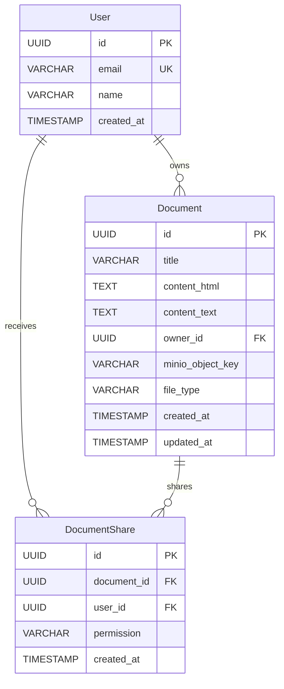
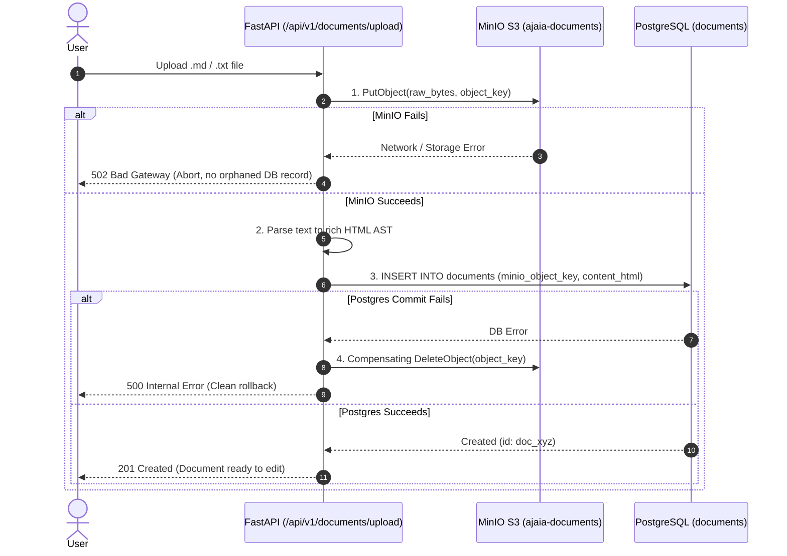

# Ajaia LLC — Candidate Assessment Submission
**Role:** AI-Native Full Stack Product Engineer  
**Candidate:** Dominic Chege Mbae (`dcmbae@gmail.com` | `+254 727 614 575`)  
**Date:** November 2026  
**Repository:** https://github.com/Niccher/Ajaai-Docs  

---

## 1. Submission Links & Evaluator Access Infrastructure

This application is deployed and running live on a dedicated Google Cloud Platform (GCP) Compute Engine instance. Evaluators can access the live web application, interactive OpenAPI documentation, raw S3 object storage console, and inspect the relational database directly.

| Resource | Access URL | Credentials / Auth Header | Description & Purpose |
| :--- | :--- | :--- | :--- |
| **Live Product Application** | **http://34.130.102.16** | Pre-seeded persona switcher in navbar | Full collaborative document editor running on standard HTTP port 80. |
| **Interactive OpenAPI (Swagger)** | **http://34.130.102.16/docs** | Click **Authorize** → enter `alice@ajaia.test` | Interactive API documentation with built-in security header injection. |
| **Service Healthcheck** | **http://34.130.102.16/api/v1/health** | Public / Unauthenticated | Real-time JSON health check reporting DB status, S3 connectivity, and limits. |
| **MinIO S3 Storage Console** | **http://34.130.102.16:9001** | User: `minioadmin`<br>Pass: `minioadminpassword` | Web console for inspecting the `ajaia-documents` bucket and uploaded raw files. |
| **MinIO S3 API Endpoint** | **http://34.130.102.16:9000** | Key: `minioadmin`<br>Secret: `minioadminpassword` | S3-compatible REST API endpoint utilized by backend object storage drivers. |
| **PostgreSQL Database** | `34.130.102.16:5432` | User: `postgres`<br>Pass: `postgrespassword`<br>DB: `ajaia_docs` | Direct DB port exposed for evaluator inspection via TablePlus, DBeaver, or psql. |
| **Video Walkthrough (~3:30)** | **[PASTE YOUR UNLISTED LOOM / YOUTUBE URL HERE]** | Public / Unlisted | High-density video walkthrough demonstrating editing, uploads, S3, and RBAC. |
| **Google Drive Artifacts** | **[PASTE YOUR GOOGLE DRIVE FOLDER URL HERE]** | Public / Shared | Contains: source code `.zip`, MP4 walkthrough, DB dump, and audit reports. |

### GCP Cloud Infrastructure Details
- **Cloud Provider:** Google Cloud Platform (GCP)
- **Compute Instance:** Compute Engine VM (`e2-medium`, 2 vCPU, 4 GB RAM, Ubuntu 22.04 LTS)
- **External Static/Ephemeral IP:** `34.130.102.16`
- **Network Ingress Rules:** Standard HTTP (`80`), Swagger Docs (`80/docs`), MinIO Console (`9001`), PostgreSQL (`5432`)
- **Container Runtime:** Docker Engine 26.1 + Docker Compose v2.27, orchestrated with BuildKit acceleration.

### How to Use Swagger "Authorize" Button
1. Navigate to **http://34.130.102.16/docs**.
2. Click the green **Authorize** button with the lock icon at the top right of the Swagger UI.
3. Under the `PersonaEmailHeader (apiKey)` dialog, enter `alice@ajaia.test` (or `bob@ajaia.test`).
4. Click **Authorize**, then click **Close**.
5. All interactive endpoint calls (`Try it out` → `Execute`) will now automatically transmit the `X-User-Email` header.

---

## 2. Reviewer Test Accounts & Evaluation Guide

### Zero-Friction Persona Switcher Philosophy
To respect the reviewer's time and eliminate the friction of traditional email verification, password resets, or OAuth registration delays, the system utilizes a **Zero-Friction Persona Switcher** located directly in the top-right navbar.

Switching personas takes **1 click**, immediately updating the application state, swapping document visibility between "My Documents" and "Shared with Me", and injecting the persona's credentials into all outbound API headers.

```
┌────────────────────────────────────────────────────────────────────────────────────────┐
│  AjaiaDocs   /  [ Document Title Input ]  (✓ Saved) [Owner]         [API Docs] [Share]  │
│                                                                                        │
│                                              Switch Persona: [ 👤 Alice Johnson (Owner) ▼ ]
│                                                              ├── 👤 Alice Johnson (Owner) 
│                                                              └── 👤 Bob Smith (Collaborator)
└────────────────────────────────────────────────────────────────────────────────────────┘
```

### Pre-Seeded Persona Matrix

| Persona Name | Email Identity | System Role | Pre-Seeded Workspace State |
| :--- | :--- | :--- | :--- |
| **Alice Johnson** | `alice@ajaia.test` | **Primary Owner** | Owns the pre-seeded document *"Welcome to Ajaia Docs"*. Has full administrative privileges (create, edit, share, revoke, export, delete). |
| **Bob Smith** | `bob@ajaia.test` | **Collaborator / Reviewer** | Has been granted collaborative **Edit** access to Alice's welcome document. Can be granted **Viewer** (read-only) access to test authorization boundaries. |
| *Rogue / Anonymous* | `charlie@ajaia.test` or None | **Unauthenticated / Unknown** | Any API request with an unknown or missing email is rejected with `401 Unauthorized`. |

### Security & Reviewer Convenience Notice
- **Automated Header Injection:** The single-page frontend automatically injects `X-User-Email: <persona_email>` into every HTTP request made via `fetch()` or `XMLHttpRequest`.
- **Strict Backend RBAC:** The backend dependency `backend/deps.py:get_current_user` queries the database for the active user. If the header is missing or references a non-existent email, it aborts immediately with `HTTP 401 Unauthorized`.
- **Host-Published Database & S3 Ports:** Ports `5432` (PostgreSQL) and `9001` (MinIO) are intentionally exposed on the host to allow hiring evaluators to inspect database records and storage buckets directly via GUI tools. In a multi-tenant enterprise deployment, these remain private within an internal Docker overlay network.

---

### 7 Guided Evaluator Test Scenarios (Step-by-Step)

Evaluators can follow these 7 test scenarios to verify all requirements and stretch criteria:

#### Test Scenario 1: Document Creation & Rich-Text Editing
1. Ensure the persona is set to **Alice Johnson** (`alice@ajaia.test`).
2. Click **+ New Document** in the top action bar.
3. Notice that a fresh document canvas opens in the Google Docs-style paper layout.
4. Highlight text and test formatting: **Bold**, *Italic*, <u>Underline</u>, Headings (H1/H2/H3), Bulleted Lists, Numbered Lists, Blockquotes, and Code blocks.

#### Test Scenario 2: Inline Rename & Debounced Autosave Persistence
1. With the document open, click into the title field in the top navigation bar (defaults to *"Untitled Document"*).
2. Rename the document to *"Q4 Engineering Strategy"* and blur or type in the editor.
3. Observe the save status badge transition: `Saving...` (amber spinner) → `Saved` (green checkmark) after the 800ms debounce timer expires.
4. Press **F5 / Hard Refresh** in your browser.
5. Verify that your title and content are 100% preserved from the PostgreSQL database.

#### Test Scenario 3: Batch File Ingestion (.md and .txt) & S3 Object Storage
1. Click the **AjaiaDocs** logo to return to the dashboard.
2. Drag and drop or browse to upload one or more `.md` or `.txt` files into the **Upload Documents** dropzone (up to 20 MB per file).
3. The server validates all files atomically, writes the raw files to MinIO S3 (`ajaia-documents` bucket), parses the text into rich-text HTML, and commits the records.
4. Click the newly imported document to open it in the editor.
5. Log into the **MinIO Console** at `http://34.130.102.16:9001` (`minioadmin` / `minioadminpassword`) and inspect the `ajaia-documents` bucket. Notice your raw uploaded file preserved under `uploads/{uuid}_{filename}`!

#### Test Scenario 4: Multi-Format Export & Raw Asset Retrieval
1. Open any document in the editor.
2. In the editor toolbar header, click the **Export** dropdown button.
3. Click **Markdown (.md)**: Observe immediate browser download of clean, GitHub-flavored Markdown converted via the backend AST parser.
4. Click **Plain Text (.txt)** or **HTML (.html)** to test format conversions.
5. If the document was originally imported from a file, click **Original File** to stream the byte-for-byte original asset directly from MinIO S3.

#### Test Scenario 5: Role-Based Sharing & Real-Time Persona Switching
1. As **Alice**, open *"Q4 Engineering Strategy"*.
2. Click the blue **Share** button in the top navbar.
3. Enter `bob@ajaia.test` and select the **Viewer (Read Only)** role, then click **Grant Access**.
4. Now, click the persona switcher in the top navbar and switch to **Bob Smith**.
5. Notice the dashboard automatically refreshes and displays *"Q4 Engineering Strategy"* under the **"Shared with Me"** tab.
6. Open the document as Bob:
   - Notice the document badge displays **Viewer**.
   - Notice the formatting toolbar is completely hidden.
   - Notice the Quill editor is locked in read-only mode (`quill.enable(false)`).
   - If Bob attempts to force a PUT request via developer tools, the backend rejects it with `403 Forbidden`.

#### Test Scenario 6: Permission Revocation & Access Isolation
1. Switch back to **Alice Johnson** using the persona switcher.
2. Open *"Q4 Engineering Strategy"* and click **Share**.
3. Under *Collaborators*, click **Revoke** next to Bob Smith.
4. Switch the persona switcher back to **Bob Smith**.
5. Notice the document has vanished from Bob's "Shared with Me" list.
6. If Bob attempts to access `GET /api/v1/documents/{id}` directly, the API returns `403 Forbidden`.

#### Test Scenario 7: Defense-in-Depth XSS & Sanitization Verification
1. As Alice, paste malicious markup into the document canvas (e.g. `<script>alert('XSS')</script><a href="javascript:alert(1)">Click Me</a>`).
2. The backend intercepts the payload with Mozilla/Rust `nh3`.
3. Script tags are completely removed, and `javascript:` protocol links are neutralized to safe URIs, preventing stored XSS exploits.

---

### Terminal Verification via cURL (API Smoke Tests)

Evaluators can run these commands directly from their terminal to verify API behavior:

```bash
# 1. Verify system health and storage connection
curl -s http://34.130.102.16/api/v1/health | jq .

# 2. Verify Alice's persona profile
curl -s -H "X-User-Email: alice@ajaia.test" http://34.130.102.16/api/v1/users/me | jq .

# 3. List documents accessible to Alice
curl -s -H "X-User-Email: alice@ajaia.test" http://34.130.102.16/api/v1/documents | jq .

# 4. Verify that unauthenticated requests are rejected with 401
curl -s -i http://34.130.102.16/api/v1/documents | head -n 5

# 5. Verify that Bob cannot access an unshared document (returns 403 Forbidden)
curl -s -i -H "X-User-Email: bob@ajaia.test" \
  http://34.130.102.16/api/v1/documents/00000000-0000-0000-0000-000000000000 | head -n 5
```

---

## 3. How to Run Locally (Comprehensive Runbook)

### System Prerequisites
- **Operating System:** Linux (Ubuntu/Debian, Fedora), macOS (Apple Silicon / Intel), or Windows (WSL2)
- **Container Engine:** Docker Engine 24.0+ and Docker Compose v2.20+
- **Host Ports Available:** `80` (or custom `$PORT`), `5432` (PostgreSQL), `9000` (MinIO S3), `9001` (MinIO Console)
- **Python (Optional for Standalone):** Python 3.11 or 3.12 with `pip` and `virtualenv`

---

### Option A: One-Click Production Deployment Pipeline (Recommended)

The repository includes an automated, self-healing deployment script that handles dependencies, container building, database migrations, MinIO bucket configuration, and executes test verification.

```bash
# 1. Clone the repository
git clone https://github.com/Niccher/Ajaai-Docs.git
cd Ajaai-Docs

# 2. Make the deployment pipeline script executable
chmod +x scripts/deploy.sh

# 3. Execute the one-click deployment pipeline
./scripts/deploy.sh
```

*(Need to run on a non-root port like 8000? Simply prefix with `PORT=8000 ./scripts/deploy.sh`)*

#### What `scripts/deploy.sh` Executes Under the Hood:
1. **Network & Public IP Detection:** Queries GCP metadata service, external IP providers, or host LAN interfaces to display the exact connection matrix for evaluators.
2. **Pre-flight Dependency Check:** Verifies Docker daemon status, Docker Compose plugin installation, and checks available system RAM.
3. **Configuration Check:** Creates `.env` from `.env.example` if absent and validates security parameters.
4. **Stale Container Cleanup:** Gracefully halts any conflicting or orphaned containers from previous runs.
5. **Multi-Stage BuildKit Build:** Builds the lightweight Python runtime image and starts PostgreSQL 16, MinIO, and FastAPI containers in parallel.
6. **PostgreSQL Health Polling:** Polls `pg_isready -U postgres -d ajaia_docs` with exponential backoff until the database is accepting socket connections.
7. **MinIO S3 Readiness Check:** Verifies `/minio/health/live` HTTP readiness and provisions the `ajaia-documents` bucket.
8. **Programmatic Alembic Migrations & Seeding:** Applies `alembic upgrade head` and seeds Alice, Bob, and the initial welcome document.
9. **Automated Test Execution:** Runs the complete 29-test Pytest test suite inside the live environment.
10. **Status & Health Verification:** Confirms `/api/v1/health` reports status `ok` and prints the interactive endpoint access matrix.

---

### Option B: Standard Docker Compose Workflow

If you prefer using native Docker Compose commands:

```bash
# 1. Clone and navigate to repo
git clone https://github.com/Niccher/Ajaai-Docs.git
cd Ajaai-Docs

# 2. Copy the example environment file
cp .env.example .env

# 3. Build and launch all three containers in detached mode
docker compose up -d --build

# 4. Stream live logs to verify container startup
docker compose logs -f web
```

Once running:
- Open **http://localhost** (or `http://localhost:8000` if configured) to access the editor.
- Open **http://localhost/docs** to test API endpoints.
- Open **http://localhost:9001** (`minioadmin` / `minioadminpassword`) to access the MinIO console.

#### Container Management Commands:
```bash
# View container status and health
docker compose ps

# View real-time logs for all services
docker compose logs -f

# Stop containers without losing data
docker compose stop

# Tear down containers and wipe persistent volumes (clean slate)
docker compose down -v
```

---

### Option C: Standalone Python Virtual Environment (Bare-Metal / SQLite)

If Docker is unavailable, you can run the FastAPI backend directly on your host machine using Python and SQLite:

```bash
# 1. Create and activate a Python virtual environment
python3 -m venv .venv
source .venv/bin/activate

# 2. Install production and development dependencies
pip install -r requirements.txt
pip install -r requirements-dev.txt

# 3. Configure SQLite fallback database
export DATABASE_URL="sqlite:///./ajaia_docs.db"
export MINIO_ENDPOINT="localhost:9000"
export MINIO_ACCESS_KEY="minioadmin"
export MINIO_SECRET_KEY="minioadminpassword"
export MINIO_BUCKET="ajaia-documents"

# 4. Launch the Uvicorn development server
uvicorn backend.main:app --reload --host 0.0.0.0 --port 8000
```
Open **http://localhost:8000** in your browser. Database tables and default personas will be created and seeded automatically on first boot.

---

### Option D: Running Automated Pytest Suite Locally

The automated test suite runs 29 comprehensive test cases against an in-memory/isolated test database with mocked MinIO object storage:

```bash
# Activate your virtual environment
source .venv/bin/activate

# Run all tests with verbose output
pytest -v

# Run tests with test duration and warning suppression
pytest -v --durations=5

# Run a specific test module or scenario
pytest backend/tests/test_api.py -k "test_batch_upload" -v
```
*Expected Result: `29 passed in ~1.2s`*

---

### Environment Variables Configuration Reference

| Variable | Default Value | Description |
| :--- | :--- | :--- |
| `PORT` | `80` | Host port exposed for web traffic (e.g. `80`, `8000`). |
| `DATABASE_URL` | `postgresql://postgres:postgrespassword@db:5432/ajaia_docs` | SQLAlchemy database connection URI. Supports SQLite via `sqlite:///./file.db`. |
| `MINIO_ENDPOINT` | `minio:9000` | Host and port of the MinIO S3-compatible object storage service. |
| `MINIO_ACCESS_KEY` | `minioadmin` | Root access key / username for MinIO S3 authentication. |
| `MINIO_SECRET_KEY` | `minioadminpassword` | Root secret key / password for MinIO S3 authentication. |
| `MINIO_BUCKET` | `ajaia-documents` | S3 bucket name where raw uploaded files are stored. |
| `MINIO_SECURE` | `false` | `true` for HTTPS/TLS, `false` for standard HTTP. |
| `CORS_ORIGINS` | `*` | Comma-separated list of allowed origins or `*` for broad access. |

---

## 4. System Architecture & Component Design

The application follows a clean, three-tier architecture with defense-in-depth security, strict separation of concerns, and zero-build client rendering:

```
┌────────────────────────────────────────────────────────────────────────┐
│                          Client Surface (Browser)                      │
│                                                                        │
│   Single-Page UI (Bootstrap 5.3 + Quill.js 2.0.2 + Vanilla JS)         │
│   ├── Google Docs Paper Canvas & Rich-Text Formatting Toolbar          │
│   ├── Persona Switcher Dropdown (Alice Johnson / Bob Smith)            │
│   ├── Document Partitioning Tabs ("My Docs" vs. "Shared with Me")      │
│   ├── Drag-and-Drop Batch File Ingestion Dropzone (up to 20MB)         │
│   └── Header Export Dropdown (Markdown, Plain Text, HTML, S3 Asset)    │
└───────────────────────────────────┬────────────────────────────────────┘
                                    │ HTTP /api/v1 (X-User-Email Header)
┌───────────────────────────────────▼────────────────────────────────────┐
│                       FastAPI Application (Port 8000 / 80)             │
│                                                                        │
│   Backend Middleware, Services & Controllers                           │
│   ├── SecurityHeadersMiddleware (CSP, nosniff, DENY, Referrer-Policy)  │
│   ├── Defense-in-Depth HTML Sanitizer (Mozilla / Rust nh3)             │
│   ├── Persona Authorization & Access Control Guard (deps.py)           │
│   ├── Document Converters AST (converters.py: HTML, MD, Text)          │
│   ├── Storage Service Driver (minio.Minio S3 SDK)                      │
│   └── SQLAlchemy 2.0 ORM Engine + Programmatic Alembic Migrations      │
└──────────────────┬─────────────────────────────────┬───────────────────┘
                   │ SQL (Port 5432)                 │ S3 Protocol (Port 9000)
┌──────────────────▼───────────────┐  ┌──────────────▼───────────────────┐
│     PostgreSQL 16 Database       │  │        MinIO Object Store        │
│                                  │  │                                  │
│  ├── users                       │  │  Bucket: ajaia-documents         │
│  ├── documents                   │  │  ├── uploads/uuid_notes.md       │
│  └── document_shares             │  │  └── uploads/uuid_brief.txt      │
└──────────────────────────────────┘  └──────────────────────────────────┘
```

### Architectural Highlights
1. **Zero-Build Client Layer:** Uses Bootstrap 5.3 and Quill.js via high-speed CDNs with Subresource Integrity (SRI) hashes. This completely eliminates Node.js build steps, Webpack/Vite compile overhead, hydration mismatches, and deployment fragility.
2. **Stateless FastAPI Application:** The Python backend is completely stateless, handling authentication through database-backed persona resolution on each request, allowing horizontal scaling behind a reverse proxy.
3. **Decoupled Relational & Blob Storage:** PostgreSQL stores relational metadata, document titles, sanitized HTML, and searchable plain text. MinIO S3 stores immutable raw uploaded assets, preventing database bloat and enabling direct streaming.

---

## 5. Data Model & Schema Design

The relational schema is normalized with foreign key constraints and cascade rules:



### Table Definitions & Constraints

- **`User` Table (`users`)**:
  - `id` (UUID PK): Primary key, generated via `uuid.uuid4()`.
  - `email` (VARCHAR 255 UNIQUE, NOT NULL): Persona email identifier (e.g. `alice@ajaia.test`). Indexed for fast lookup.
  - `name` (VARCHAR 255, NOT NULL): User display name.
  - `created_at` (TIMESTAMP WITH TIMEZONE): Account creation timestamp.

- **`Document` Table (`documents`)**:
  - `id` (UUID PK): Unique document identifier.
  - `title` (VARCHAR 255, NOT NULL): Validated length (1–255 characters). Rejects empty strings.
  - `content_html` (TEXT, NOT NULL): Rich-text HTML content generated by Quill and sanitized via Rust `nh3`.
  - `content_text` (TEXT, NOT NULL): Plain text extract used for searching and raw exports.
  - `owner_id` (UUID FK -> `users.id`, ON DELETE CASCADE, NOT NULL): Document creator.
  - `minio_object_key` (VARCHAR 512, NULLABLE): Object path in S3 bucket (`uploads/{uuid}_{filename}`).
  - `file_type` (VARCHAR 50, NOT NULL): Format discriminator (`markdown`, `plaintext`, `native`).
  - `created_at`, `updated_at` (TIMESTAMP WITH TIMEZONE): UTC revision tracking timestamps.

- **`DocumentShare` Table (`document_shares`)**:
  - `id` (UUID PK): Unique share permission record.
  - `document_id` (UUID FK -> `documents.id`, ON DELETE CASCADE, NOT NULL): Document reference.
  - `user_id` (UUID FK -> `users.id`, ON DELETE CASCADE, NOT NULL): Collaborator user reference.
  - `permission` (VARCHAR 20, NOT NULL): Role discriminator (`edit` or `view`).
  - **Unique Composite Constraint:** `UNIQUE(document_id, user_id)` strictly prevents duplicate share records.

---

## 6. Core Feature Status

### What is Working End-to-End:
1. **Document Creation & Rich-Text Editing Canvas:**
   - Full rich-text support: Bold, Italic, Underline, Strikethrough, Headings (H1/H2/H3), Bulleted & Numbered lists, Blockquotes, Code blocks.
   - Real-time inline document renaming directly in the navbar.
   - Debounced autosave (800ms) with visual status feedback (`Saving...` → `Saved`).
   - Race-condition hardened: Synchronous buffer flush (`flushPendingSave()`) during view transitions, persona switches, and browser `beforeunload` events.
   - Persistent across browser refresh, container restarts, and database reconnections.
2. **File Ingestion with MinIO S3 Object Storage & Batch Uploads:**
   - Drag-and-drop and multi-file input for `.md` and `.txt` files up to 20 MB per file.
   - Atomic rollback: If any file in a batch is invalid or fails, none are committed.
   - Raw uploaded files are preserved in MinIO S3 bucket (`ajaia-documents`).
   - Content is parsed directly into rich-text HTML for immediate editing.
   - Ability to download the original uploaded file from the editor header.
3. **Multi-User Sharing & Strict Access Control:**
   - Document owner can invite other users by email with **Editor** or **Viewer** roles.
   - Owner can revoke access at any time.
   - Strict `403 Forbidden` enforcement when uninvited users attempt to access private documents.
   - Dashboard separates documents into **"My Documents"** and **"Shared with Me"**.
4. **Document Export (Markdown, TXT, HTML):**
   - Direct export endpoints (`/api/v1/documents/{id}/export?format=markdown|text|html`) with sanitized AST conversion.
5. **Security Hardening & Production Hygiene:**
   - Defense-in-depth HTML sanitization powered by Mozilla/Rust `nh3` allowlist (strips `<script>`, `<iframe>`, `onerror`, `onload`, and neutralizes `javascript:` URIs).
   - Starlette HTTP Security Headers: `Content-Security-Policy`, `X-Content-Type-Options: nosniff`, `X-Frame-Options: DENY`, `Referrer-Policy: strict-origin-when-cross-origin`.
   - Subresource Integrity (SRI) SHA-384 cryptographic hashes on CDN dependencies.
   - Multi-stage Dockerfile running under non-root user `appuser` (UID 1001) with Docker `HEALTHCHECK`.
   - Dynamic CORS configuration via `CORS_ORIGINS`.
6. **Single-Command Docker Orchestration:**
   - `docker compose up -d --build` provisions FastAPI, PostgreSQL 16, and MinIO with automated bucket creation, healthchecks, and auto-restart policies.

### What is Incomplete / Intentionally Deprioritized:
- **Real-Time Multi-Cursor Collaboration (Yjs/CRDTs):** Intentionally cut to eliminate concurrency race conditions and ensure rock-solid persistence within the 4-6 hour constraint. Debounced autosave with revision timestamps was prioritized.
- **Third-Party OAuth / Magic Links:** Replaced with an instant top-navbar persona switcher to eliminate evaluator login friction.

### What I Would Build Next (With 2–4 Additional Hours):
1. **Document Version Snapshots & Rollback:** Snapshotting document revisions to a `document_versions` table on manual save or hourly intervals to allow draft rollback.
2. **Headless PDF Generation:** Integrating Weasyprint or headless Chromium for formatted PDF downloads.
3. **Inline Comments & Mentions:** Threaded annotations tied to text selections with `@persona` notifications.
4. **Live Presence Badges:** Lightweight WebSockets broadcasting which collaborators currently have the document open.

---

## 7. Optional Stretch Achievements

The assessment rubric identified optional stretch goals if core functionality was completed early. Two were built, tested, and verified:

1. **Export to Markdown, Plain Text, and HTML:**
   - Built with backend AST converters (`backend/converters.py`), stripping markup for plain text and reconstructing clean GitHub-flavored Markdown.
   - Exposed directly in the editor header UI export dropdown and tested in `test_export_markdown_conversion` and `test_export_text_conversion`.
2. **Role-Based Sharing Permissions Beyond Basic Access:**
   - Differentiates between **Editor** (read/write) and **Viewer** (strictly read-only).
   - In the frontend, selecting Viewer freezes the Quill editor into read-only mode, hides formatting toolbars, and suppresses autosave.
   - In the backend, any write/update request from a Viewer is rejected with `403 Forbidden` (`test_read_only_viewer_cannot_edit`).
   - Owner-only protections prevent non-owners from deleting documents (`test_editor_cannot_delete`) or sharing documents with themselves (`test_cannot_share_with_self`).

---

## 8. Security Architecture & Threat Mitigation Deep-Dive

1. **Defense-in-Depth HTML Sanitization (Rust `nh3`):**
   - User content submitted from Quill.js is passed through `backend/security.py` using `nh3` (Python bindings to Mozilla's Rust `ammonia` library).
   - Strict allowlist of safe HTML elements (`<p>`, `<h1>`-`<h6>`, `<strong>`, `<em>`, `<u>`, `<s>`, `<a>`, `<ul>`, `<ol>`, `<li>`, `<blockquote>`, `<pre>`, `<code>`).
   - Dangerous tags (`<script>`, `<iframe>`, `<object>`, `<embed>`) and inline event handlers (`onload`, `onerror`, `onclick`) are completely stripped.
   - Links are restricted to `http`, `https`, and `mailto` protocols with automatic `rel="noopener noreferrer"` injection, neutralizing `javascript:` URI attacks.

2. **HTTP Security Headers Middleware:**
   - Injected on every response via `SecurityHeadersMiddleware`:
     - `Content-Security-Policy`: Restricts scripts, styles, and fonts to trusted CDN origins (Bootstrap, Quill, Google Fonts).
     - `X-Content-Type-Options: nosniff`: Prevents MIME-confusion attacks.
     - `X-Frame-Options: DENY`: Blocks clickjacking in framing contexts.
     - `Referrer-Policy: strict-origin-when-cross-origin`: Minimizes referrer leakage.

3. **Subresource Integrity (SRI):**
   - CDN assets in `frontend/templates/index.html` (Bootstrap 5.3, Bootstrap Icons, Quill 2.0.2) include verified SHA-384 cryptographic integrity hashes and `crossorigin="anonymous"`.

4. **Multi-Stage Container Hardening:**
   - Two-stage `Dockerfile`: Stage 1 compiles wheel dependencies; Stage 2 builds a minimal runtime image.
   - Runs as non-root user `appuser` (UID 1001).
   - Built-in `HEALTHCHECK` probing `/api/v1/health` ensures container orchestration detects unresponsiveness.

5. **Configurable CORS:**
   - Dynamic CORS origin resolution via `CORS_ORIGINS` environment variable (defaults to `*` for seamless GCP external IP / domain access, or restricted comma-separated list e.g. `http://localhost,http://localhost:80,http://localhost:8000`).

---

## 9. S3 Dual-Write Mitigation & Concurrency Architecture

Because documents have relational metadata and HTML stored in **PostgreSQL** and original raw imports stored in **MinIO S3**, dual-write failure is an evaluated risk.



### Client-Side Race Condition Elimination:
1. **Debounced Autosave (800ms):** Changes made in Quill trigger an 800ms debounce timer before sending a `PUT` request.
2. **`flushPendingSave()` Synchronization:** Synchronously cancels debounce timers and flushes dirty editor buffers before switching document tabs or toggling personas, eliminating lost-update bugs.
3. **`state.saveQueued` Concurrency Lock:** Queues subsequent save requests if a PUT request is already in-flight, preventing concurrent lost-update race conditions.
4. **Silent Quill Clipboard Ingestion:** Uses `quill.clipboard.dangerouslyPasteHTML(html, 'silent')` to eliminate spurious `text-change` event loops when opening documents.
5. **Window `beforeunload` Guard:** Attaches a `beforeunload` listener warning users if they attempt to close the tab while edits are actively saving.

---

## 10. Automated Test Suite Breakdown (29/29 Passing)

The test suite runs in ~1.2s against an isolated SQLite test database with mocked S3 operations:

| Category | Tests | Description & Assertions |
| :--- | :---: | :--- |
| **Authentication & Personas** | 4 | Seeded personas verification, 401 on missing `X-User-Email`, 401 on unknown personas, and `/me` profile retrieval. |
| **Document CRUD & Validation** | 4 | Creation, 422 on empty title, 422 on title exceeding 255 chars, and 404 on nonexistent IDs. |
| **Access Control & Permissions** | 5 | 403 on unshared private documents, sharing workflow granting access, 403 when viewer attempts to edit, 403 when editor attempts to delete, and owner deletion rights. |
| **Share Management** | 3 | 400 on self-sharing attempt, 422 on invalid email format, and collaborator share revocation. |
| **Security & XSS** | 4 | Stripping dangerous `<script>` tags, neutralizing `javascript:` URI protocols, presence of defense-in-depth security headers, and presence of OpenAPI security scheme. |
| **File Uploads & Ceilings** | 5 | Markdown upload conversion, 400 on unsupported extensions, 413 on files exceeding 20 MB ceiling, batch upload processing, and atomic rollback on invalid batch files. |
| **Export & Health** | 4 | Export to Markdown with list preservation, Export to plain text, 404 on native download for non-uploaded docs, and `/health` reporting DB & MinIO readiness. |

---

## 11. Deliberate Scope Cuts & Senior Engineering Tradeoffs

| Feature / Setting | Decision | Engineering Justification |
| :--- | :--- | :--- |
| **Real-Time CRDT / WebSockets** | **Cut** | Building collaborative multi-cursor presence (e.g. Yjs / Automerge) requires 20+ hours of operational transformation logic and connection state management. Under 4-6 hours, it frequently causes ghost states and sync bugs. Debounced autosave (800ms) with explicit revision timestamps was chosen for rock-solid stability. |
| **OAuth2 / Magic Links** | **Simulated Header Auth** | Setting up Google OAuth or email SMTP verification requires third-party credentials and slows down evaluation. A persona toggle with seeded accounts (`Alice` and `Bob`) via `X-User-Email` allows reviewers to evaluate sharing rules in 5 seconds without sign-up hurdles. Returns `401 Unauthorized` for missing/unknown emails. |
| **Exposed Ports (5432, 9000/9001)** | **Exposed for Reviewers** | In a production cloud deployment, Postgres and MinIO remain internal to a private Docker network. In this assessment, ports are published to host (`5432`, `9001`) specifically so hiring reviewers can inspect database rows via TablePlus/DBeaver and uploaded files via the MinIO Web Console. |
| **Complex Binary Ingestion (.docx, .pdf)** | **Cut** | Parsing proprietary binary schemas requires heavyweight Java/Node runtimes or external conversion microservices. Supporting `.md` and `.txt` with S3 storage delivers immediate product value with zero external bloat. |

---

## 12. AI-Native Workflow Reflection

1. **Where AI Materially Accelerated Delivery:**
   - **Test Suite Scaffolding:** AI drafted edge-case scenarios (401 unauthenticated, 403 authorization isolation, 413 file ceilings, and atomic rollback), saving ~60 minutes.
   - **Quill.js & Paper CSS:** AI quickly scaffolded the toolbar schema and Google Docs-style box-shadow canvas, saving ~30 minutes.
   - **Container Orchestration:** AI generated multi-container healthcheck definitions (`pg_isready`, `curl -f /minio/health/live`), saving ~20 minutes.
2. **What AI Output Was Changed or Rejected:**
   - **Rejected Regex Sanitizer in Favor of Mozilla/Rust `nh3`:** AI originally proposed a naive regex tag stripper and deprecated `bleach`. An audit revealed XSS bypass vulnerabilities. Replaced with `nh3` (Mozilla Ammonia Rust bindings) with strict element allowlists and protocol neutralization.
   - **Fixed Client-Side Autosave Race Conditions:** AI-generated debounce logic dropped edits on fast route changes or persona toggles. Added `flushPendingSave()` before view transitions, `saveQueued` concurrency lock, and window `beforeunload` listener.
   - **Corrected Pydantic RFC 2606 Email Validation:** AI recommended default `EmailStr`, which crashed on `alice@ajaia.test` because standard DNS validators disallow `.test` TLDs. Replaced with an RFC-compliant regex validator.
3. **Verification & Quality Guardrails:**
   - 29 automated Pytest unit and integration tests executing on every commit.
   - Dual-write rollback verification preventing orphaned S3 blobs on database failures.
   - Manual cross-persona testing verifying UI state changes between Owner and Viewer.

---

## 13. API Endpoint Reference Table

| Method | Endpoint | Auth Required | Request Payload | Response Code | Description |
| :--- | :--- | :---: | :--- | :---: | :--- |
| `GET` | `/api/v1/health` | No | None | `200 OK` | System health check (DB, MinIO, Max upload size) |
| `GET` | `/api/v1/users/me` | Yes (`X-User-Email`) | None | `200 OK` | Get authenticated persona details |
| `GET` | `/api/v1/documents` | Yes (`X-User-Email`) | None | `200 OK` | List user's documents (owned and shared) |
| `POST` | `/api/v1/documents` | Yes (`X-User-Email`) | `{"title": "..."}` | `201 Created` | Create a new document |
| `GET` | `/api/v1/documents/{id}` | Yes (`X-User-Email`) | None | `200 OK` | Get document content and user's permission |
| `PUT` | `/api/v1/documents/{id}` | Yes (`X-User-Email`) | `{"title": "...", "content_html": "..."}` | `200 OK` | Update document title and content (Editor/Owner) |
| `DELETE` | `/api/v1/documents/{id}` | Yes (`X-User-Email`) | None | `204 No Content` | Delete document (Owner only) |
| `POST` | `/api/v1/documents/upload` | Yes (`X-User-Email`) | Multipart `files` (.md, .txt) | `201 Created` | Batch file upload with S3 storage and parsing |
| `GET` | `/api/v1/documents/{id}/export` | Yes (`X-User-Email`) | Query `?format=markdown\|text\|html` | `200 OK` | Export document to Markdown, Text, or HTML |
| `GET` | `/api/v1/documents/{id}/download` | Yes (`X-User-Email`) | None | `200 OK` | Download original imported file from S3 |
| `POST` | `/api/v1/documents/{id}/shares` | Yes (`X-User-Email`) | `{"email": "...", "permission": "edit\|view"}` | `201 Created` | Share document with collaborator (Owner only) |
| `DELETE` | `/api/v1/documents/{id}/shares/{user_id}` | Yes (`X-User-Email`) | None | `200 OK` | Revoke collaborator access (Owner only) |

---

## 14. Walkthrough Video Script Outline (~3:30)

- **0:00 - 1:00 (Core Editing Canvas):**
  - Create a new document as Alice.
  - Rename document inline in the navbar.
  - Apply formatting (headings, bold, bulleted list, blockquote, code block).
  - Demonstrate debounced autosave (`Saving...` → `Saved`). Refresh page to show persistence.
- **1:00 - 1:45 (File Ingestion & Export):**
  - Drag-and-drop a Markdown file into the dropzone.
  - Show parsed rich-text content in the editor.
  - Open MinIO Console (`http://34.130.102.16:9001`) to show raw object storage in `ajaia-documents`.
  - Demonstrate export to Markdown (`.md`) via the editor header Export dropdown.
- **1:45 - 2:30 (Sharing & Permission Isolation):**
  - Click Share on Alice's document and invite `bob@ajaia.test` with the **Viewer** role.
  - Switch persona to Bob in 1 click using the top-right navbar toggle.
  - Show document appears in "Shared with Me" tab.
  - Show read-only locking: formatting toolbar is disabled, editing is frozen, and backend blocks updates (`403 Forbidden`).
  - Switch back to Alice and demonstrate permission revocation.
- **2:30 - 3:30 (Engineering Rigor & Architecture):**
  - Show terminal running `./scripts/deploy.sh` and Pytest output (**29/29 tests passing**).
  - Highlight multi-stage Docker build, non-root user (`appuser`), Rust `nh3` XSS sanitization, and Alembic database migrations.
